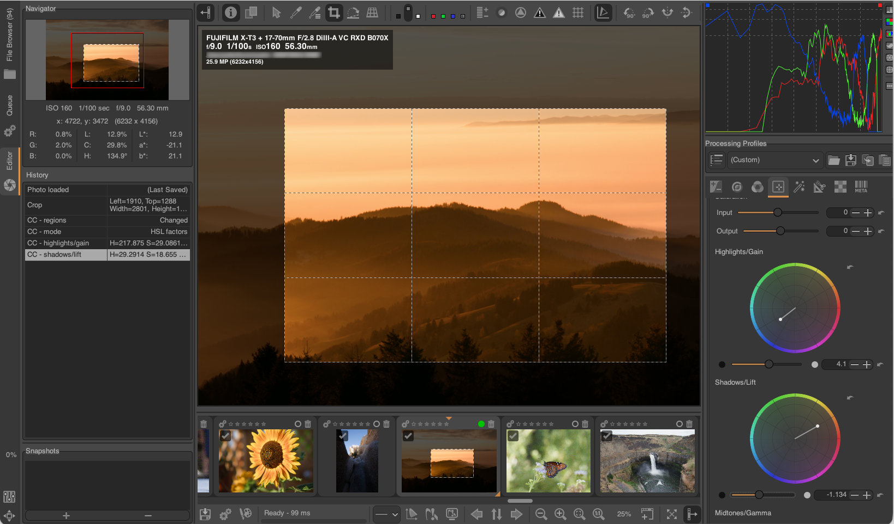

# About

Welcome to the home page of ART, a [free, open-source](https://www.gnu.org/philosophy/philosophy.html), cross-platform 
raw image processing program. 
ART started out as a fork of the popular [RawTherapee](http://rawtherapee.com),
with the goal of offering a simpler interface and a more streamlined workflow, 
trading a bit of customization and control over various processing parameters for ease of use.
Over time, it has evolved into an independent project with its own development direction:
the user interface and the processing pipeline have been largely restructured and rewritten, 
and ART now offers its own streamlined set of tools and features, 
while still building on the demosaicing and processing foundations inherited from RawTherapee.

## Features

ART and RawTherapee still share part of their heritage: the demosaicing algorithms (AMaZE, RCD, LMMSE, X-Trans, etc.) 
and many of the underlying image processing routines come from the common ancestor.
However, the two projects have diverged significantly since ART forked from a development version of RawTherapee between versions 5.5 and 5.6, 
and ART differs from RawTherapee in the following main aspects:

- The user interface and the underlying processing pipeline have been significantly restructured, with many tools removed, some new tools added, and several tools rewritten and/or refactored. 

- Various new tools for performing local edits have been added, with support for various masking modes (both drawn and parametric).

- Better metadata handling (thanks to the [exiv2](http://exiv2.org) and [exiftool](http://exiftool.org) libraries), with (optional) support for reading and writing XMP sidecar files.

- Support for various [input and output custom image formats](Customformats) via a simple plugin system, including various [true HDR output formats](Hdroutput).

- Optional [Vulkan](https://www.vulkan.org) GPU acceleration of the most demanding tools (e.g. denoising and smoothing), included in the official binary releases.

- Raw files are decoded with [LibRaw](https://www.libraw.org).

- Support for [ACES CLF LUTs](https://docs.acescentral.com/clf/specification/) using [OpenColorIO](https://opencolorio.org/).

- Support for [CTL scripts](https://acescentral.com/knowledge-base-2/ctl/) using the [ACES CTL interpreter](https://github.com/ampas/CTL).

- Easy integration of [external tools](Usercommands), including [AI-based ones](AItools) for masking, denoising and inpainting.

- A new automatic perspective correction tool (adapted from [darktable](http://darktable.org)) has been added.

- Star ratings and colour labels can be loaded and stored from/to XMP sidecar files.

- Snapshots are now permanent, saved in the processing profiles.

- Processing profiles have `.arp` extension instead of `.pp3`, to avoid conflicts with RawTherapee.

- The "inspector mode" tool of the file browser has been significantly enhanced.

## Status

The current version is 1.26.11. It was released on November 10th 2026. 
[Change log](https://github.com/artraweditor/ART/compare/1.26.10...1.26.11).

## License 
ART is released under the [GNU General Public License version 3](https://www.gnu.org/licenses/gpl.html).
